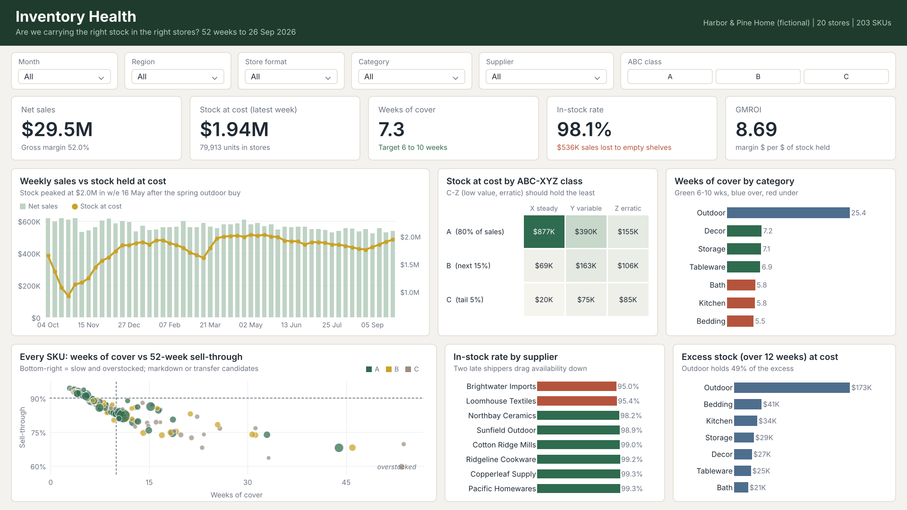
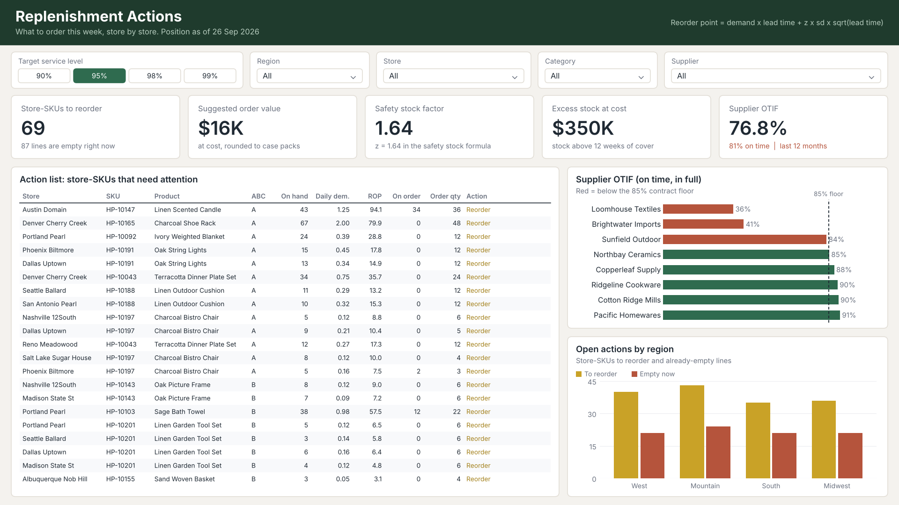

# Retail Inventory Health & Replenishment




## The business problem

Harbor & Pine Home (a fictional 20-store home-goods chain) has the classic retail inventory problem: too much of the wrong stock and not enough of the right stock. Cash is tied up in slow lines while best sellers run empty, and two suppliers keep shipping late and short. Page one gives the merchandising team the health check: in-stock rate, weeks of cover, GMROI and where the excess sits. Page two is the store-level replenishment list a buyer can work through on a Monday morning, with a reorder point and a suggested order quantity for every store and SKU.

## Data

Synthetic, generated week by week by `scripts/generate_data.py`. Demand follows category seasonality (garden peaks in May, bedding in winter) and promotions; each store reorders against a rough reorder point; suppliers have their own lead times, lateness and fill rates. Units sold are capped by stock on hand, so out-of-stocks really do lose sales. Planted problems:

- two suppliers (Loomhouse Textiles and Brightwater Imports) that ship late and short
- an over-bought outdoor range in the spring
- products ordered for every store that only sell in the flagships
- a messy product master: inconsistent category casing and prices stored as text with a currency sign

| File | Grain |
|---|---|
| `data/weekly_store_sku.csv` | store x SKU x week: units, sales, receipts, closing stock, days out of stock |
| `data/purchase_orders.csv` | one row per PO line, with expected and received dates and quantities |
| `data/products.csv` | 203 SKUs (raw, needs cleaning) |
| `data/stores.csv` | 20 stores with region, format and floor space |

## Semantic model

- Facts: **Inventory Weekly** (store x SKU x week) and **Purchase Orders** (PO line)
- Dimensions: **Products**, **Stores**, **Date**
- **Service Level** is a disconnected table of target service levels and their z-scores, used in the safety stock formula. Change the slicer and every reorder point recalculates.

## Power Query (ETL)

- Category text trimmed and proper-cased (`Text.Proper(Text.Trim(...))`) so "kitchen", "KITCHEN" and "Kitchen " become one category.
- Prices like "$1,249.00" stripped of the currency sign and thousands separator, then typed as currency.
- Retail margin (IMU %) and price bands added to the product master.
- PO lines get on-time and in-full flags against the expected date and ordered quantity, plus days late.

## DAX worth looking at

- **ABC class** (calculated column): Pareto on 52-week net sales. A is the first 80% of sales, B the next 15%, C the tail.
- **XYZ class** (calculated column): coefficient of variation of weekly demand. X under 0.3, Y under 0.5, Z otherwise. The ABC x XYZ matrix shows where stock should and shouldn't sit.
- **Stock on Hand** is semi-additive: it takes the last week that has stock rows in the current filter context (`LASTNONBLANK`), so stock is never summed across weeks.
- **Safety Stock** = z x demand standard deviation x the square root of lead time. **Reorder Point** = lead-time demand + safety stock.
- **Suggested Order Qty** orders up to the reorder point plus two weeks of demand, rounded up to whole cases.
- **Action** labels every store-SKU ("Empty - order now", "Empty - chase open PO", "Reorder", "Overstock - transfer"), and the action list uses a measure-based visual filter to show only lines that need attention.
- **Lost Sales (est.)** scales each week's sales rate up to the days the line was out of stock.
- **GMROI** and **OTIF %** (on time, in full) for supplier scorecards.

## What the data says

- **$29.5M** net sales at a **52%** gross margin; GMROI **8.69**.
- In-stock rate **98.1%** overall, but lines from the two problem suppliers sit well below that.
- Average cover is **7.3 weeks**, and roughly **$350K** of stock sits above 12 weeks of cover, most of it in the spring outdoor over-buy.
- Supplier OTIF is **76.8%** against an 85% contract floor. Loomhouse and Brightwater are the reason.

## Design choices

- Page one answers "are we healthy?", page two answers "what do I do this week?". They are separate audiences, so they are separate pages.
- Cover colours follow a simple rule shown in the subtitle (green 6 to 10 weeks, blue over, red under), not a gradient nobody can read.
- The scatter of every SKU (weeks of cover vs sell-through) marks the slow, overstocked corner, so the markdown and transfer candidates are obvious without training.

## Opening it

1. Use a recent Power BI Desktop. If your version still lists them under File > Options > Preview features, turn on the Power BI Project (.pbip) save option, TMDL and the enhanced report format (PBIR).
2. Clone the repo into `C:\PowerBI-Portfolio\`, which is where the model looks for its data by default:
   ```
   cd C:\PowerBI-Portfolio
   git clone https://github.com/GOkul069/RetailInventory.git
   ```
   Anywhere else works too: open the project and set the **DataFolder** parameter (Transform data > Edit parameters) to the repo's `data` folder, keeping the trailing backslash.
3. Open the `.pbip` file and click Refresh.

The weekly fact file is about 12 MB, so the first refresh takes a little longer than the others.

The project was written as PBIP source files and checked with the Analysis Services TMDL parser, Microsoft's PBIR JSON schemas and `automation/check_pbip.py`, rather than built by clicking in Desktop. The preview images are rendered from the same data. If spacing looks slightly different from the preview the first time you open it, that is why.

## Automation

`automation/` holds a pre-deployment check, a script that publishes to a Power BI / Fabric workspace and refreshes the model, and a GitHub Actions workflow. See [automation/README.md](automation/README.md).

## Part of a six-project Power BI portfolio

- [Telecom customer churn and retention campaign planner](https://github.com/GOkul069/TelecomChurn)
- [Telecom network operations, anomaly detection and SLA](https://github.com/GOkul069/NetworkOperations)
- [Retail inventory health and store replenishment](https://github.com/GOkul069/RetailInventory)
- [E-commerce marketplace growth and delivery experience (Olist)](https://github.com/GOkul069/EcommerceOlist)
- [Diabetes inpatient 30-day readmissions and risk stratification](https://github.com/GOkul069/HospitalReadmissions)
- [Healthcare revenue cycle, A/R and claim denials](https://github.com/GOkul069/RevenueCycle)
